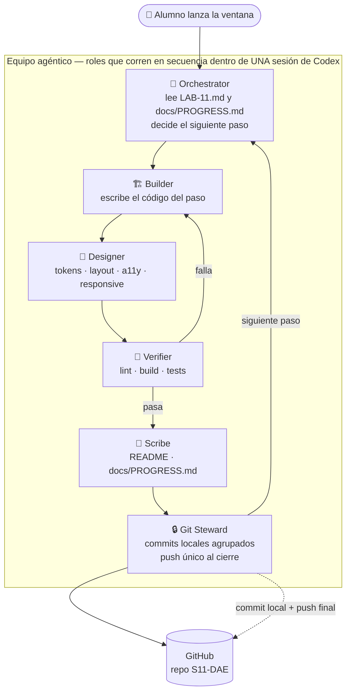
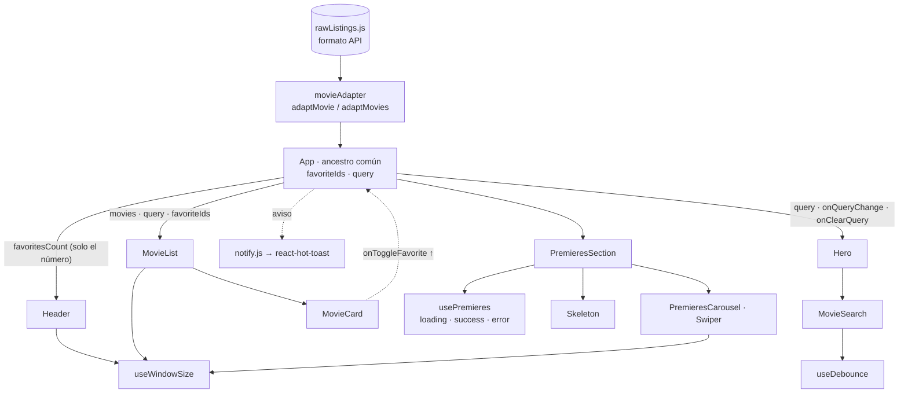

# S11-DAE — Laboratorio 11: Comunicación entre componentes

Extiende Aurora Cinemas con comunicación entre hermanos, hooks propios y estados de carga/error.
Se evalúan estado compartido, extracción de lógica y bibliotecas de interfaz.
Rama: `lab-11`.

## Estructura agéntica



```text
 ┌────────────────────── CICLO DE TRABAJO ────────────────────────┐
 │ [PLAN] → [BUILD] → [DESIGN] → [VERIFY] → [NOTES] → [COMMIT]   │
 │   ▲                      │                         │           │
 │   └──────────────── falla┘            grupos cortos│           ▼
 │                                           [PUSH ÚNICO] → [ESTADO]
 └─────────────────────────────────────────────────────────────────┘
```

## Arquitectura del laboratorio



## Árbol previsto

```text
S11-DAE/
├── AGENTS.md · README.md · docs/PROGRESS.md
└── cinema-app/
    ├── public/posters/
    └── src/
        ├── App.jsx · App.test.jsx · main.jsx
        ├── data/ (rawListings · rawPremieres · movies)
        ├── hooks/ (useDebounce · useWindowSize · usePremieres)
        ├── services/notify.js · utils/movieAdapter.js · styles/
        ├── test/setup.js
        └── components/
            ├── Button/ · Header/ · Footer/ · Hero/
            ├── MovieSearch/ · MovieList/ · MovieCard/
            └── Premieres/ (Skeleton · PremieresCarousel · PremieresSection)
```

## Comandos y reglas

En `cinema-app/`: `npm install`, `npm run dev`, `npm run lint`, `npm run build`, `npm test`.
Código en inglés; documentación en español. No subir dependencias instaladas, `dist` ni secretos. Commits locales agrupados y push único al final según preferencia del alumno.

Dependencias principales: React 19, Vite 8, Vitest 5, React Hot Toast 2.6 y Swiper 14.

## Diseño y terminado

Se conserva el diseño oscuro y ámbar de Aurora, CSS por componente, foco visible y layout adaptable. El laboratorio termina con búsqueda/favoritas, hooks compartidos, carrusel con estados de carga/error, README/PROGRESS actualizados y lint, build y pruebas aprobados.
